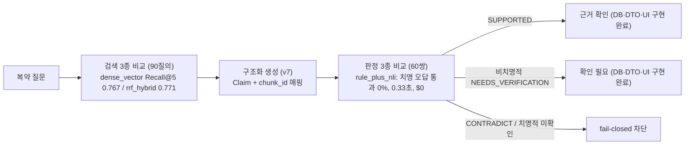

# 복약 Chat RAG 실측 고도화 v1 결과 및 팀·개인 프로젝트 비교

- **기준 브랜치 / 기준 리비전**: `feat/chat-rag-measured-slice-v1` (base `3297d83`)
- **작성일**: 2026-11-26 ~ 2026-11-27 (KST)
- **관련 정본**:
  - [ADR 0004: 복약 Chat RAG 실측 고도화 v1 선정과 측정 기준](../../adr/0004-chat-rag-measured-slice-selection.md)
  - [제품 요구사항](chat-rag-measured-slice-requirements.md) (`CRM-01`–`CRM-13`)
  - [기능 명세](chat-rag-measured-slice-design.md) · [구현 계획](chat-rag-measured-slice-plan.md)
  - [공유 계약 제안/승인본 (`chat-claim-citation-v1.md`)](../../contracts/proposed/chat-claim-citation-v1.md)

> **상태 및 공개 경계**: 이 문서는 **Wave 1~5(기반 점검·계약·스키마·UI·식약처 평가 코퍼스 수집·검색/판정기 실측·`rule_plus_nli` 런타임 opt-in 연결·포트 `5433` 실DB E2E·안전 회귀·독립 리뷰 보완)** 완료 결과를 요약한다. 계약 `current/` 승격, 기본 DI(`get_chat_engine`) 전역 활성화, `Dockerfile` AI 런타임 패키징, `PUBLIC_TRACK_F_ENABLED=false` 및 [외부 승인 게이트](../../release-gates/post-mvp-1-external-approvals.md)는 닫힌 상태를 유지하며 Human Owner의 별도 결정이 필요하다.

---

## 1. 한눈에 보는 결론 및 파이프라인 흐름

Wave 4까지 **검색(Retrieval)과 근거 검증(NLI + 안전 규칙)**을 같은 한국어 복약 평가 기준으로 정량 측정했다. 총 OpenAI 실험 비용은 **\$0.061792**(4주 상한 \$30의 약 `0.2%`)다.

- **검색 핵심 결과**: `text-embedding-3-large` 기반 의미 검색(`dense_vector`, `Recall@5 0.7671`)과 혼합 검색(`rrf_hybrid`, `Recall@5 0.7714`)이 글자 일치 기반 `bm25_lexical`(`0.5513`)보다 **`+22.0%p`** 유의하게 높았다(Paired Bootstrap 95% CI `[+0.1517, +0.2949]`).
- **판정 핵심 결과**: 로컬 NLI 모델(`MoritzLaurer/mDeBERTa-v3-base-mnli-xnli`) 단독(`local_nli`)은 `Critical False-Support Rate 0.0500`으로 `ADR 0004` 상한(`<= 0.02`)을 넘겼으나, 한국어 수치·복용 시점·금기 규칙을 결합한 **`rule_plus_nli`**는 **치명적 오답 통과 `0.0000`**, **모순 재현율 `1.0000`**, **`Macro-F1 0.9666`**, **CPU `P95 332.594 ms`**, **추가 API 비용 `\$0`**을 기록했다.

---

## 2. 팀 프로젝트(`AH_05_04`) vs 개인 프로젝트(`Dosey`) 비교

과거 팀 프로젝트 시절의 기능 구현과, 개인 프로젝트로 전환한 뒤 **실측·고도화·안전 경계 보강**을 거치며 달라진 점은 아래와 같다.

| 비교 항목 | 과거 팀 프로젝트 (`AH_05_04` 기준) | 개인 프로젝트 고도화 (`Dosey` Wave 1–4) |
| --- | --- | --- |
| **개선 목표 및 방식** | 여러 기능 동시 구축, Chat RAG는 제한 시연(`CLOSED_DEMO`) 및 미연결 골격 위주 | `ADR 0004` 단일 수직 슬라이스 선정 → 지표·예산(\$30) 고정 후 ablation 기반 선택 |
| **생성 모델·프롬프트** | `chat-prompt-v6` 자유 텍스트 답변만 반환 (`citations` 없음) | `chat-prompt-v7-claim-citation` 구조화 JSON(`answer` + `claims[]` + `chunk_id`), 미등록 `chunk_id` fail-closed 차단 |
| **추가된 AI 모델** | OpenAI 생성·임베딩 중심 (로컬 NLI 판정 모델 미사용) | **`MoritzLaurer/mDeBERTa-v3-base-mnli-xnli`** 로컬 CPU NLI(`551.51 MB`, `torch 2.11`·`sentence-transformers 5.2`) 추가 및 `gpt-4o-mini` 비교 기준선 확보 |
| **근거 검증 방식** | 답변 내 각 주장(Claim) 단위 지지·모순 자동 검증 미구현 | **`rule_plus_nli`**: 한국어 수치·용법(`1일 1회`/`2회`)·시점(`식전`/`식후`)·금기 규칙 + NLI 결합 (`Macro-F1 0.9666`, 치명 오답 통과 `0%`) |
| **검색 평가 기준** | 단일·합성 구성 중심, 한국어 구어체/기권 분리 정량 비교 없음 | 식약처 실데이터 `26품목·964청크` 기반 `90질의`(`pos 78` / `neg 12`)로 `bm25`·`dense`·`rrf` 동시 비교 및 95% CI 검증 |
| **공유 계약·DB 스키마** | `chat_citation` 테이블 미사용, `POST`/`GET` Chat DTO에 인용 필드 없음 | 승인 계약([chat-claim-citation-v1.md](../../contracts/proposed/chat-claim-citation-v1.md)) 기반 `SendChatMessageData`·`ChatMessageData` 선택 `citations` 추가, forward migration `926a1b2c3d4e` (Trigger/RLS 없이 `CHECK` 제약만 사용) |
| **프론트엔드 UI** | `AssistantMessageContent` 평문/Markdown 답변만 표시 | Markdown 안전 경계는 유지하면서 답변 하단에 `근거 확인` / `확인 필요` 출처 카드 분리 렌더링 (`ChatPage.tsx`) |
| **로컬 데이터·DB 격리** | 단일 Compose `postgres:5432` 전제, `nedrug` 수동 XML 의존 | 기존 `ah_05_04`(`5432`) 무변경 보호 + 포트 `5433` 격리 `pgvector 0.8.6` 컨테이너, 승인된 `data.go.kr` `15095677` (`DrugPrdtPrmsnInfoService07/getDrugPrdtPrmsnDtlInq06`) 비공개 로컬 수집 |

### 실측을 통해 발견·수정한 핵심 엔지니어링 사례

1. **NLI 입력 순서 역전 버그 수정 (`Support Recall 0.00 -> 1.00`)**: Wave 2 첫 스모크([nli-smoke 기록](../../archive/testing/chat-rag-nli-smoke-20261126.md))에서 `support` 2건이 모두 `neutral(0.9992)`로 무너졌다. 원인 분석 결과 `citation_nli_smoke.py:650`이 `(premise, hypothesis)` 대신 `(claim, evidence)` 역순을 넣었음을 확인했고, `citation_judge_compare.py`에서 `(evidence, claim)` 정순으로 고쳐 `Support Recall 1.0000`을 회복했다.
2. **CPU 지연 단축 (`P95 3645.7 ms -> 332.6 ms`)**: 25청크 장문을 전부 NLI에 넣어 3.65초가 걸리던 문제를 **한국어 어휘·바이그램 기반 Top-3 문장 사전 필터링**으로 줄여 약 `11배` 빠르게 만들었다.
3. **식약처 `15095677` 실제 운영 경로 정합화**: `DrugPrdtPrmsnInfoService07` 서비스 아래 상세 조회 오퍼레이션은 `getDrugPrdtPrmsnDtlInq06`이 HTTP `200`으로 응답함을 실측으로 확인해 [mfds_eval_corpus.py](../../../apps/ai_worker/tasks/evaluation/mfds_eval_corpus.py) 기본 경로에 반영했다.

---

## 3. Wave 1–4 정량 실측 결과

### 3.1 식약처 비공개 로컬 평가 코퍼스 (`mfds-eval-corpus-builder`)

상세 기록: [chat-rag-mfds-eval-corpus-20261126.md](../../archive/testing/chat-rag-mfds-eval-corpus-20261126.md)

| 항목 | 실측 값 | 비고 |
| --- | --- | --- |
| 입력 시드 / 수집 성공 / 스킵 | `40` / `26` / `14` | 스킵 14건: `EE`·`UD` 빈 DOC XML `13`건, 미매칭 `1`건(fail-closed 제외) |
| 생성 청크 수 (`EE` / `UD` / `NB`) | `964` (`51` / `113` / `800`) | 저장소 외부(`/private/tmp/dosey-mfds-eval-corpus`)에만 보관 |
| `chunks_sha256` / `manifest_sha256` | `4bc6f64e...` / `64b1fc14...` | `eval_corpus_local_only: true`, `release_eligible: false` |

### 3.2 검색 Ablation 실측 (`retrieval-ablation`, `90`질의)

상세 기록: [chat-rag-retrieval-ablation-20261126.md](../../archive/testing/chat-rag-retrieval-ablation-20261126.md) · 임베딩: `text-embedding-3-large` (`444,414` 토큰, **`$0.057774`**)

| Arm | Recall@5 | MRR@5 | nDCG@5 | No-hit@5 | SecHit@5 | PosTop1 | NegTop1 | Gap | P50 (ms) | P95 (ms) |
| --- | ---: | ---: | ---: | ---: | ---: | ---: | ---: | ---: | ---: | ---: |
| `bm25_lexical` | 0.5513 | 0.5141 | 0.4631 | 0.2692 | 0.7949 | 52.1412 | 24.3696 | 27.7716 | 1.547 | 3.555 |
| `dense_vector` | 0.7671 | **0.7442** | 0.6963 | **0.0769** | **0.9487** | 0.6614 | 0.4565 | **0.2049** | 47.845 | 97.278 |
| `rrf_hybrid` | **0.7714** | 0.7417 | **0.6974** | 0.1026 | 0.9103 | 0.0319 | 0.0293 | 0.0026 | 50.178 | 99.398 |

- **Paired Bootstrap 95% CI (`Recall@5` 차이, `N=78`)**: `rrf_hybrid - bm25_lexical = +0.2201` (`[+0.1517, +0.2949]`), `dense_vector - bm25_lexical = +0.2158` (`[+0.1132, +0.3141]`), `rrf_hybrid - dense_vector = +0.0043` (`[-0.0727, +0.0748]`).

### 3.3 Citation 판정기 실측 (`citation-judge-compare`, `60`쌍)

상세 기록: [chat-rag-citation-judge-compare-20261126.md](../../archive/testing/chat-rag-citation-judge-compare-20261126.md) · OpenAI Judge 비용: **`$0.004018`**

| Judge | Macro-F1 | Support Recall | Neutral Recall | Contradict Recall | Crit Contradict Recall | Crit False-Support Rate | ADR 0004 (`<=0.02`) | P50 (ms) | P95 (ms) | Total Cost ($) |
| --- | ---: | ---: | ---: | ---: | ---: | ---: | :---: | ---: | ---: | ---: |
| `local_nli` | 0.9158 | 1.0000 | 0.9000 | 0.8500 | 0.7000 | 0.0500 | **FAIL** | 190.587 | 356.475 | 0.000000 |
| `rule_plus_nli` | **0.9666** | 1.0000 | 0.9000 | **1.0000** | **1.0000** | **0.0000** | **PASS** | **197.658** | **332.594** | **0.000000** |
| `openai_llm_judge` | **1.0000** | 1.0000 | 1.0000 | 1.0000 | 1.0000 | 0.0000 | **PASS** | 1286.966 | 2091.049 | 0.004018 |

---

## 4. Wave 5 런타임 연결·실 DB E2E·안전 회귀·독립 리뷰 반영 (`PASS`)

Wave 4에서 1순위로 확인된 `rule_plus_nli` 검증기를 [chat_claim_citation_validator.py](../../../packages/rag_runtime/chat_claim_citation_validator.py) (`packages/rag_runtime`, `ai_worker`/`app` 무참조 순수 모듈)로 구현하고, [chat_generator_engine.py](../../../apps/backend/app/services/chat_generator_engine.py)에 opt-in(`closed_demo_retriever` + `citation_validator`)으로 연결했다.

### 4.1 Wave 5 핵심 안전·런타임 정책 (Human Owner A1–A4 확정)

1. **치명적 모순 전체 차단 (`A1`)**: `CRITICAL` Claim 중 `contradict`가 1건이라도 나오면 `CriticalClaimContradictionError` → `ChatGenerationFailedError`로 답변 본문 자체를 `FAILED`(`content=null`, `chat_citation` 0건) 처리한다. `CRITICAL + neutral` 및 `NON_CRITICAL + contradict`는 `citations` 목록에서 fail-closed 제외한다.
2. **Opt-in 격리 (`A2`)**: `citation_validator=None`이면 기존 `chat-prompt-v6`·`chat-prompt-v7-closed-demo-evidence` 흐름을 100% 보존한다. 검증기 활성화 시 앱 DB `knowledge_chunk_id`가 없는 근거가 들어오면 무음 폐기하지 않고 `ChatGenerationFailedError`로 fail-closed 실패한다.
3. **다중 문장·한국어 활용형 안전 가드 (`H1`)**: 임의 중단·증량·감량·2배 복용 패턴과 문장 종결 구분자를 적용해 `"상태에 따라 임의 감량할 수 있습니다. 절대 두 배로 복용하지 마세요."` 같은 2문장 우회를 차단하면서, `"임의로 복용을 중단하지 마세요"` 같은 안전 권고는 오탐 없이 `SUPPORTED`로 통과시킨다.

### 4.2 Wave 5 전체 검증 결과 및 `dosey_reviewer` 리뷰 조치

| 구분 | 실행 범위 및 결과 | 비고 |
| --- | --- | --- |
| **오프라인 안전 회귀·계약·단위 (`PASS`)** | `test_chat_citation_safety_regression.py`·`test_chat_citation_contract.py`·`test_chat_service.py`·`chat_ai`·`evaluation` 4종 **`365 passed, 1 skipped`**, `tests/contract/` **`13 passed`** | `claim_text` 상한 `1000` 통일, 다중 문장·한국어 활용형·`캡슐`/`알`·타임아웃·기존 `v6` 보존 포함 |
| **실시간 PostgreSQL `5433` E2E & 마이그레이션 (`PASS`)** | `alembic downgrade 925a1b2c3d4e` → `upgrade head` (`926a1b2c3d4e`) 왕복 PASS, `test_chat_citation_runtime_e2e.py`·`test_chat_message_api.py`·`test_chat_repository.py` **`38 passed in 4.61s`** | 실 PostgreSQL `POST`/`GET` 인용 영속화, `CRITICAL+contradict` `500 FAILED` + 0행, `CHECK` 제약 거부 직접 확인 |
| **기존 Holdout Safety 기준선** | `test_holdout_safety_dataset.py`·`test_safety_metrics.py` `114 passed`, `1 failed` | 1건 실패는 기존 macOS 샌드박스 `/var/folders` `EVAL_ATOMIC_PUBLISH_UNSUPPORTED` 제약 |
| **Frontend (`PASS`)** | `ChatApi`·`ChatPage`·`AssistantMessageContent` **`89 passed`**, `tsc -b`, `oxlint` 0 오류 (이전 Wave 3 전체 `vitest` 49파일 `992 passed`·`vite build` PASS) | `FAILED`·`GENERATING` 메시지 인용 숨김 방어 추가 |
| **정적·DB 정책·위생 (`PASS`)** | `ruff check .`, `ruff format --check` (`1378` files), `mypy` (`1007` source files), `check_python_test_inventory.py`, `check_database_logic.py`, `verify_database_head.py` (`926a1b2c3d4e`), `check_agent_hygiene.py`, `git diff --check` 모두 통과 | 추가 OpenAI 비용 `$0` (누적 Wave 1–5 총액 **`$0.061792`**) |
| **`dosey_reviewer` 독립 리뷰 반영** | `BLOCKING` 2건(`B1` 무음 폐기 → fail-closed 예외 전환, `B2` `docs/contracts/README.md`·`docs/api.md`·`test_chat_ai_backend_contract.py` 동기화), `HIGH` 1건(`H1`), `MEDIUM` 3건(`M1`~`M3`), `LOW`(`L1`, `L3`) 해결 | **남은 배포 후속 범위**: `source591_staging` ↔ 앱 DB `knowledge_chunk_id` 통합, `dependencies/services.py` DI 연결, `Dockerfile` `ai` 그룹 포함 여부, `chat-claim-citation-v1.md` `current/` 승격 및 PR 생성은 Human Owner 결정 대상 |
| **참고 한계** | 1) Wave 4 검색 90질의·판정 60쌍은 결정적 합성 평가셋 기준이며, 2) `test_holdout_safety_dataset.py` CLI 1건과 `evaluation/` `atomic publish` 88건은 macOS `/var/folders` 제약으로 별도 환경 검증 대상이다. | — |
